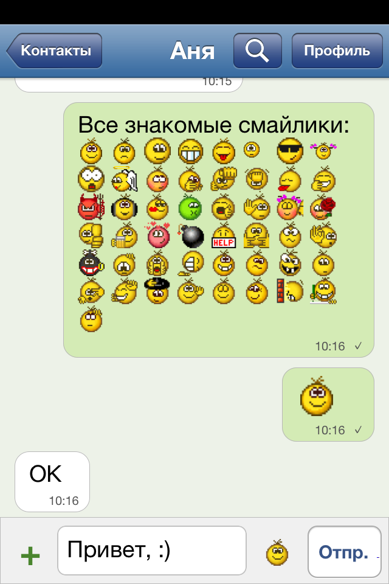
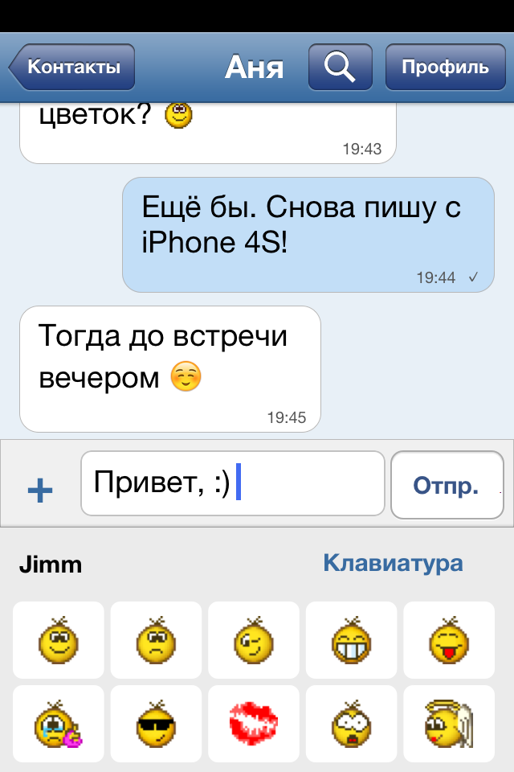
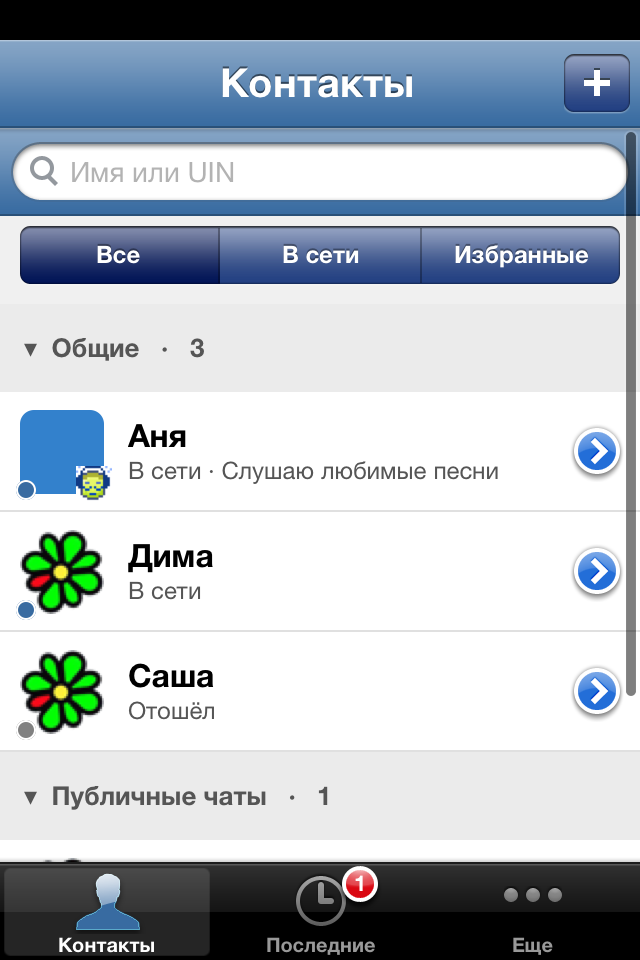
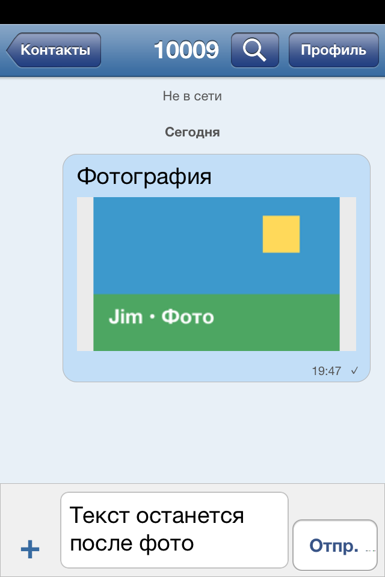

# Jim Classic — ICQ для старых iPhone

<p align="center">
  
</p>

**Знакомая аська на классическом iPhone.** Контакты, сообщения, фотографии,
смайлики и X-статусы — в нативном интерфейсе с темами ICQ, QIP и Jimm.

**Сборка 16 · iOS 6.1.3–6.1.6 и iOS 9.x · ARMv7 · Jailbreak + AppSync**

Jim Classic — полноценное самостоятельное приложение для общения в сети **Jimm.online**.
Оно устанавливается на домашний экран и работает напрямую с сервисом, без
браузерной оболочки. Это независимый клиент, а не официальное приложение ICQ.

**В JimmStore приложение называется Jim Classic. В Cydia ищите «Jim (iOS 6)» или «Jim (iOS 9)».**

[Установить Jim](#install-jim) · [Возможности](#jim-features) · [Фотографии](#jim-photos) · [Обновление](#update-jim) · [Загрузки](https://github.com/MiChiRose/Jim-iOS/releases)

## Новое в сборке 16

- После восстановления связи накопившиеся сообщения приходят быстрее, а чат остаётся отзывчивым.
- Чаты с длинной историей открываются быстрее. Пока история загружается, можно прокручивать чат и писать. При повторном открытии Jim пропускает неизменившиеся записи.

Оба улучшения проверены на iPhone 4S с iOS 6.1.3. Версия пакетов Cydia — **0.1.0-16**.

<a name="install-jim"></a>

## Установка Jim через Cydia

**Для новой установки достаточно самого iPhone. Компьютер и терминал не нужны.**

### 1. Проверьте совместимость

| Что нужно | Подробности |
| --- | --- |
| **iPhone с ARMv7** | Приложение разработано для iPhone 4S. Вход и текстовая переписка подтверждены на iPhone 4S с iOS 6.1.3. |
| **iOS 6.1.3–6.1.6 или iOS 9.x** | В Cydia есть отдельный пакет для каждой системы. iOS 7 и 8 этими пакетами не поддерживаются. |
| **Jailbreak и Cydia** | Установка на обычную iOS без jailbreak не поддерживается. |
| **AppSync Unified** | Установите версию, совместимую с вашей iOS, из доверенного источника. В нашем источнике AppSync не распространяется. |

### 2. Добавьте источник MiChiRose

Откройте **Cydia → Управление → Источники → Изменить → Добавить**:

```text
https://michirose.github.io/cydia/
```

Если источник уже добавлен для Telegraphica, достаточно обновить список пакетов.

### 3. Выберите пакет для своей iOS

| Ваша система | Пакет в Cydia |
| --- | --- |
| iOS 6.1.3–6.1.6 | **Jim (iOS 6)** |
| iOS 9.x | **Jim (iOS 9)** |

Нажмите **«Установить → Подтвердить»**, дождитесь окончания установки и откройте
**Jim** с домашнего экрана. Одновременно устанавливать оба пакета не нужно.

### 4. Войдите в Jimm.online

Введите **свой UIN и пароль Jimm.online**. Каждый пользователь входит в собственный
аккаунт. При выборе «Запомнить вход» токен сохраняется в Связке ключей; пароль
не записывается на диск. Контакты и доступные сообщения загрузятся после входа.

<details>
<summary><strong>Если Jim уже установлен через USB или IPA</strong></summary>

Пакет Cydia использует другое место установки. Перенос данных между этими
способами ещё не реализован, поэтому установщик останавливается при обнаружении
USB/IPA-копии. Сохраните существующий Jim и его историю; не удаляйте приложение
ради обхода проверки. Это ограничение перехода, а не требование для новых пользователей.

</details>

<a name="jim-features"></a>

## Возможности Jim

- **Переписка:** отправка и получение сообщений, состояния отправки, цитирование,
  копирование текста и индикатор набора. «Принято сервером» означает приём
  сообщения сервером, а не прочтение собеседником.
- **История:** локальное сохранение, поиск по переписке с переходом к найденному
  сообщению, загрузка ранней истории и кнопка перехода к новым сообщениям.
- **Удобный ввод:** многострочное поле, сохранение черновиков и палитра смайликов.
- **Контакты:** поиск, добавление по UIN, избранные, группы и фильтры; переименование,
  перенос между группами, удаление из списка, блокировка и разблокировка.
- **Профиль:** аватары контактов и выбор собственного аватара, сетевые статусы,
  X-статусы с подписью.
- **Фотографии:** выбор из фототеки или камеры, предпросмотр перед отправкой,
  карточки в чате и просмотр с увеличением.
- **Оформление:** темы ICQ, QIP и Jimm, знакомые смайлики и настройка размера текста.
- **Оповещения:** звук, вибрация, непрочитанные и тихие чаты при работе приложения.
- **Связь:** восстановление соединения при истечении сессии, смене сети и возврате в приложение; сохранённая
  история и черновики доступны без сети. Повтор неподтверждённой отправки — вручную.
- **Ссылки:** открытие обычных адресов в Safari и копирование полного URL.

<table>
  <tr>
    <td align="center" width="50%"></td>
    <td align="center" width="50%"></td>
  </tr>
  <tr><td align="center"><strong>Компактная переписка</strong></td><td align="center"><strong>Смайлики</strong></td></tr>
  <tr>
    <td align="center" width="50%"></td>
    <td align="center" width="50%"></td>
  </tr>
  <tr><td align="center"><strong>Контакты и статусы</strong></td><td align="center"><strong>Переписка и фотографии</strong></td></tr>
</table>

*Снимки интерфейса из iOS 6 Simulator. Контакты, сообщения и фотографии демонстрационные.*

<a name="jim-photos"></a>

## Как отправить фотографию

1. Откройте чат и нажмите **«+»** слева от поля ввода.
2. Выберите **«Фототека»** или **«Камера»**.
3. Проверьте снимок и получателя на экране предпросмотра.
4. Нажмите **«Отправить»**. Уже набранный текст останется в черновике.

Нажмите карточку фото в чате, чтобы открыть его. Увеличение работает щипком
и двойным нажатием. Загрузку можно отменить; после ошибки доступен ручной повтор.

При первом использовании фотосервис может отдельно попросить пароль аккаунта
прямо на телефоне. Пароль не сохраняется. Снимок уменьшается до 1280 пикселей
по большей стороне; исходные метаданные, включая GPS, не переносятся в JPEG.
Доступность фотографии зависит от фотосервиса Jimm.online.

<a name="update-jim"></a>

## Обновление Jim

Откройте Cydia, обновите источники и установите доступное обновление **Jim**
поверх версии, ранее установленной через Cydia. Не удаляйте приложение или
историю перед обновлением. Отдельного обновления из самого Jim пока нет.

[Страница Jim и установка](https://michirose.github.io/cydia/depictions/jim/) ·
[Загрузки на GitHub](https://github.com/MiChiRose/Jim-iOS/releases)

## Совместимость и доступные функции

Jim работает с Jimm.online. Фоновый приём при закрытом приложении, голосовые
сообщения, видео и звонки не реализованы. iOS 9, другие модели iPhone, чистая
установка из Cydia и живой обмен фотографиями ещё не прошли ту же проверку на
физическом устройстве, что вход и текстовая переписка на iPhone 4S / iOS 6.1.3.

## Ваши данные

В установочных файлах нет чужого аккаунта, переписки, паролей и личных снимков.
История и черновики сохраняются на телефоне с разделением аккаунтов. Токены
входа хранятся в Связке ключей, если включено запоминание входа. Удаление пакета
Cydia не выполняет отдельную очистку истории или токенов.

При проблеме укажите **модель iPhone, версию iOS, сборку и точный текст ошибки**.
Если Cydia остановилась на загрузке зависимости, например Core Utilities,
важно записать название пакета и адрес источника из ошибки: это отдельный этап
до установки Jim. Не публикуйте пароли, токены и личную переписку.

---


В этом репозитории размещены описание и установочные файлы Jim для iOS.
